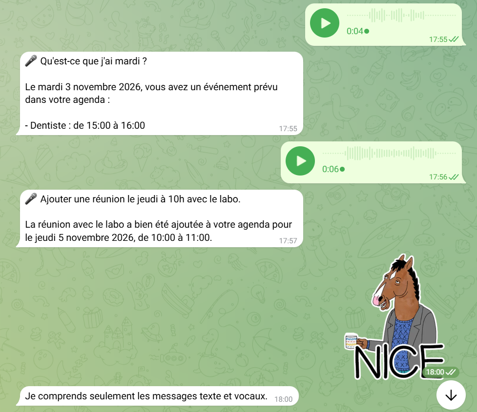
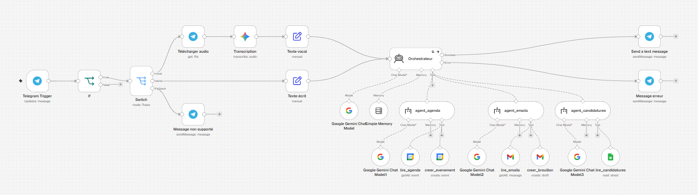
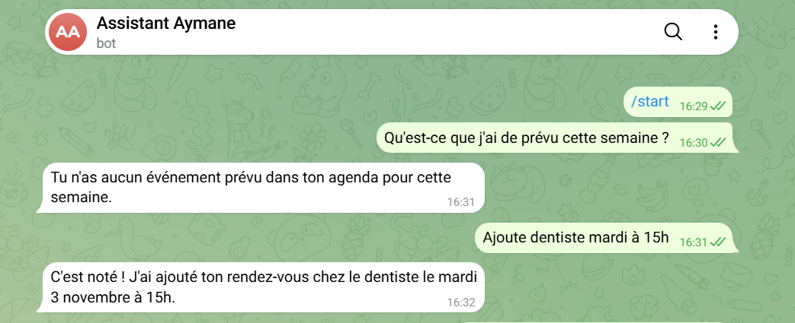
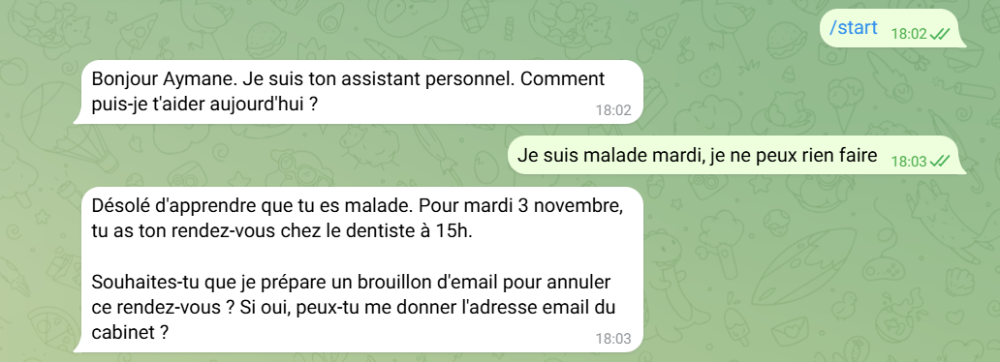

# Personal AI Agent (n8n + Gemini + Telegram)

A personal assistant I use every day, built with n8n as a **multi-agent system**. I talk to it on Telegram in natural language; an **orchestrator agent** decides which specialised agent to call to read or update my **Google Calendar**, my **Gmail** inbox and my **job-application tracker** (Google Sheets).

> **Current version:** v2.1 (orchestrator + 3 specialised agents, text **and voice** input). Previous versions are kept in `workflows/` and as [releases](../../releases).

| Voice messages (v2.1) | Multi-agent routing (v2.0) |
|---|---|
|  |  |

---

## What it does

| I write or say on Telegram | What happens |
|---|---|
| "What do I have on Tuesday?" | Orchestrator → `agent_agenda` → `lire_agenda` with the exact date range |
| "Add dentist Tuesday at 3pm" | Orchestrator resolves "Tuesday" to an exact date → `agent_agenda` → `creer_evenement` |
| "Which important emails did I get in the last 2 days?" | Orchestrator → `agent_emails` → `lire_emails` (Gmail search syntax), newsletters and ads filtered out |
| "How many applications did I send, and which are pending?" | Orchestrator → `agent_candidatures` → `lire_candidatures` (read-only Google Sheet) |
| 🎤 Voice: "Add a meeting with the lab on Thursday at 10" | Voice note downloaded → transcribed by Gemini → the transcription is shown back (🎤 ...) → orchestrator → `agent_agenda` → `creer_evenement` |
| A photo or a sticker | Polite refusal: "I only understand text and voice messages" (no LLM call) |
| "I'm sick on Tuesday" | Orchestrator → `agent_agenda` to find the affected events, then **asks for my approval and the recipient's address** before calling `agent_emails` to create cancellation drafts |

---

## Architecture (v2.1)



```
Telegram Trigger
   └─► If (chat ID allow-list)
          └─► Switch (message type)
                ├─ voice ─► Telegram · Get file ─► Gemini 3.1 Flash-Lite · Transcribe ─► texte ─┐
                ├─ text  ─► texte ────────────────────────────────────────────────────────────┤
                └─ other ─► Telegram · "text and voice only"                                    │
                                                                                               ▼
              ORCHESTRATOR ── Gemini 3.5 Flash · Simple Memory (10 messages, keyed by chat ID)
                │              retry ×3 (5 s) · error output
                ├─ agent_agenda        ── Gemini 3.1 Flash-Lite
                │     ├─ lire_agenda          Google Calendar · Get Many
                │     └─ creer_evenement      Google Calendar · Create
                ├─ agent_emails        ── Gemini 3.1 Flash-Lite
                │     ├─ lire_emails          Gmail · Get Many (search query)
                │     └─ creer_brouillon      Gmail · Draft · Create
                └─ agent_candidatures  ── Gemini 3.1 Flash-Lite
                      └─ lire_candidatures    Google Sheets · Get Rows (read-only)
                │
                ├─ success ─► Telegram · Send message (HTML mode, escaped)
                └─ error   ─► Telegram · "AI service temporarily overloaded"
```

Sub-agents are n8n **AI Agent Tool** nodes: for the orchestrator, each one is a single tool. Tool parameters (dates, search queries, email fields) are filled by the models at run time with `$fromAI()`.

---

## Design decisions

| Decision | Why |
|---|---|
| **Normalise inputs before the agent** (v2.1) | Voice and text are both converted into one `texte` field before the orchestrator, so the agent logic doesn't change with the input type. Adding a new input (e.g. photos) means adding one branch, not touching the agents. |
| **Show the transcription back** (v2.1) | Each voice answer starts with what the bot understood (🎤 ...), so a speech-recognition error is visible immediately instead of producing a silent wrong action. |
| **Unsupported messages rejected without an LLM call** (v2.1) | Photos, stickers or files go to a fallback branch: no wasted quota, no hallucinated answer. |
| **Orchestrator + specialised agents** (v2) | An agent with many tools picks the wrong tool more often. Each sub-agent has 1–2 tools and a short, focused system prompt; the orchestrator only routes and talks to me. Adding a new domain means adding one agent, not rewriting one big prompt. |
| **Self-contained delegation** | Sub-agents have no memory and don't see the conversation. The orchestrator must pass a complete request with absolute dates ("Tuesday 3 November 2026", never "tomorrow"). |
| **Strong model for routing, light model for execution** | The orchestrator (Gemini 3.5 Flash) does the hard part: understanding and planning. Sub-agents (Gemini 3.1 Flash-Lite) execute narrow tasks. Cheaper, and the free-tier quota is per model. |
| **No "send email" tool** | Only drafts can be created. Nothing leaves my inbox without me reviewing it: safety by construction, not by prompt. |
| **Approval before any email action** | For an absence, the orchestrator lists affected events and waits for my explicit "yes" + recipient address before delegating to `agent_emails`. |
| **Read-only access to the application tracker** | The agent can report on my applications but cannot modify the sheet. |
| **Chat ID allow-list** (`If` node) | A Telegram bot is publicly reachable; other chats are dropped before reaching any LLM or Google account. |
| **Retry + error branch** | Gemini's free tier returns occasional `503` errors. The orchestrator retries 3 times, then sends a clear message instead of failing silently. |
| **Plain text + HTML escaping** | Telegram's Markdown parser rejects unbalanced `*` / `_` (common in email addresses). |
| **Dedicated Gemini API project** | Rate limits apply per project; this agent doesn't share quota with my other workflows. |

---

## Setup

1. Import `workflows/assistant-personnel-v2.1.json` into n8n (**⋯ → Import from file**).
2. Create the credentials: **Telegram API** (token from [@BotFather](https://t.me/BotFather)), **Google Gemini API** (Google AI Studio), **Google Calendar**, **Gmail** and **Google Sheets** (OAuth2).
3. In the `If` node, replace `YOUR_TELEGRAM_CHAT_ID` with your chat ID (send one message to the bot and read `message.chat.id` in the trigger output).
4. In `lire_candidatures`, replace `YOUR_GOOGLE_SHEET_ID` with your tracker's ID (sheet name: `Candidatures`).
5. Calendar tools use your `primary` calendar by default.
6. Publish the workflow and write to your bot.

Tool names and prompts are in French because I use the assistant in French.

---

## Limitations

- **No quantitative evaluation yet.** Tested manually on the scenarios above. A test set measuring routing and tool-selection accuracy is planned (v2.4).
- **Latency:** about 6–10 s per text message in v2 (orchestrator + sub-agent = at least 4 LLM calls), versus 2–3 s in v1; voice adds one transcription call.
- **Transcription quality** depends on audio quality and accent; mitigated by showing the transcription back, not measured yet.
- **Free-tier LLM:** subject to rate limits and `503` errors at demand peaks (handled by retry + error message).
- **Date interpretation** depends on the model; the confirmation message makes mistakes visible.
- **Simple Memory** is short-term and not persistent across n8n restarts.
- **Single user** by design.
- **Privacy:** email snippets and calendar titles are sent to the Gemini API.

---

## Versions & roadmap

- [x] **v1.0**: single agent, 4 tools (Calendar and Gmail), Telegram interface. See `workflows/assistant-personnel-v1.json`
- [x] **v2.0**: multi-agent: orchestrator + `agent_agenda`, `agent_emails`, `agent_candidatures`; retry and error handling
- [x] **v2.1**: Telegram voice messages (Gemini transcription), transcription shown back, unsupported message types rejected
- [ ] **v2.2**: proactive morning briefing (scheduled)
- [ ] **v2.3**: approve / cancel buttons before any write action
- [ ] **v2.4**: evaluation set (~15 prompts) with routing and tool-selection accuracy, using n8n Evaluations

### v1.0 demo

| Reading and updating the calendar | Handling an absence: multi-step reasoning |
|---|---|
|  |  |

---

## Tech stack

n8n · Multi-agent orchestration (AI Agent + AI Agent Tool) · Google Gemini · Telegram Bot API · Gemini audio transcription · Google Calendar, Gmail and Sheets APIs

## Author

**Aymane Snoussi**, Master's in AI & Connected Objects
[GitHub](https://github.com/AYMANE-SNOUSSI) · [LinkedIn](https://www.linkedin.com/in/aymane-snoussi)