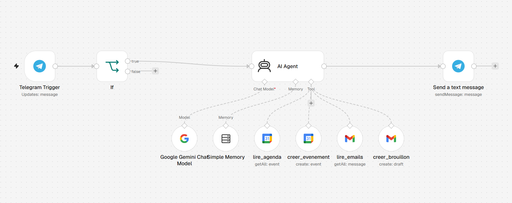

# Personal AI Agent (n8n + Gemini + Telegram)

A personal assistant **agent** I use every day, built with n8n. I talk to it on Telegram in natural language; it decides by itself which tools to call to read or update my **Google Calendar** and my **Gmail** inbox.

> **Version:** v1.0 (single agent). A multi-agent version (orchestrator + specialised sub-agents) is in progress, see [Roadmap](#roadmap).

| Reading and updating the calendar | Handling an absence: multi-step reasoning |
|---|---|
|  |  |

---

## What it does

| I write on Telegram | What the agent does |
|---|---|
| "What do I have on Tuesday?" | Calls `lire_agenda` with the right date range and lists the events |
| "Add dentist Tuesday at 3pm" | Resolves "Tuesday" to an exact date, calls `creer_evenement`, confirms title, day and time |
| "Which important emails did I get in the last 2 days?" | Calls `lire_emails` with a Gmail search query, filters out newsletters and ads, summarises each email in one line |
| "Draft an email to X saying I'll be absent on Monday" | Calls `creer_brouillon`: creates a **draft** in Gmail, never sends it |
| "I'm sick on Tuesday" | Reads the calendar for that day, finds the affected appointments, proposes cancellation drafts and **asks for the missing email address instead of inventing it** |

The last case is what makes it an agent rather than a fixed workflow: the model chains several tools and asks for missing information on its own, guided only by its system prompt.

---

## Architecture



```
Telegram Trigger
   └─► If (chat ID allow-list)
          └─► AI Agent ── Chat model: Google Gemini 3.1 Flash-Lite
                │        ── Memory: Simple Memory (last 10 messages, keyed by Telegram chat ID)
                │        ── Tools:
                │             • lire_agenda       Google Calendar  · Event · Get Many
                │             • creer_evenement   Google Calendar  · Event · Create
                │             • lire_emails       Gmail            · Message · Get Many (Gmail search syntax)
                │             • creer_brouillon   Gmail            · Draft · Create
                └─► Telegram · Send message (HTML parse mode, escaped output)
```

Tool parameters (dates, search query, email subject and body, etc.) are filled by the model at run time using n8n's `$fromAI()` mechanism.

---

## Design decisions

| Decision | Why |
|---|---|
| **No "send email" tool** | The agent can only create drafts. Nothing leaves my inbox without me reviewing it: safety by construction rather than by prompt. |
| **Chat ID allow-list** (`If` node) | A Telegram bot is publicly reachable. Messages from any other chat are dropped before reaching the LLM or my Google accounts. |
| **Current date injected in the system prompt** | Without it, the model cannot resolve "tomorrow" or "Tuesday". All dates passed to tools use ISO 8601 with the `Europe/Paris` offset. |
| **"Ask, never guess" rule** | If a title, time or recipient address is missing, the agent asks before acting. |
| **Plain-text output + HTML escaping** | Telegram's Markdown parser rejects unbalanced `*` / `_` (common in email addresses). Output is sent in HTML mode with `&`, `<`, `>` escaped. |
| **Dedicated Gemini API project** | Rate limits apply per Google Cloud project; this agent does not share quota with my other workflows. |
| **Memory keyed by chat ID** | Allows follow-up messages ("yes, prepare it") within a conversation. |

---

## Setup

1. Import `workflows/assistant-personnel-v1.json` into n8n (**⋯ → Import from file**).
2. Create the credentials:
   - **Telegram API**: bot token from [@BotFather](https://t.me/BotFather)
   - **Google Gemini API**: key from Google AI Studio
   - **Google Calendar OAuth2** and **Gmail OAuth2**
3. In the `If` node, replace `YOUR_TELEGRAM_CHAT_ID` with your own chat ID. Send one message to the bot and read `message.chat.id` in the trigger output.
4. The two Calendar tools use your `primary` calendar by default; select another one if needed.
5. Publish the workflow and write to your bot.

Tool names and the system prompt are in French because I use the assistant in French. The agent answers in French.

---

## Limitations

- **No quantitative evaluation yet.** It has been tested manually on the scenarios above only. A test set with tool-selection accuracy is planned (see Roadmap).
- **Free-tier LLM.** Subject to Gemini rate limits and occasional `503 Service Unavailable` errors during demand peaks.
- **Date interpretation** depends on the model. Ambiguous phrasing ("next Tuesday" on a Monday) can be resolved differently from what the user meant; the confirmation message makes this visible.
- **Simple Memory** is kept in the n8n instance memory: short-term only, not persistent across restarts.
- **Single user** by design (allow-list on one chat ID).
- **Privacy:** email subjects and snippets are sent to the Gemini API to be summarised.

---

## Roadmap

- [x] **v1.0**: single agent, Calendar and Gmail tools, Telegram interface
- [ ] **v2.0**: multi-agent: an orchestrator delegating to `agent_agenda`, `agent_emails` and `agent_candidatures` (job-application tracker in Google Sheets); retry and error message on LLM failure
- [ ] **v2.1**: Telegram voice messages (speech-to-text)
- [ ] **v2.2**: proactive morning briefing (scheduled)
- [ ] **v2.3**: approve / cancel buttons before any write action
- [ ] **v2.4**: evaluation set (~15 prompts) with tool-selection accuracy, using n8n Evaluations

---

## Tech stack

n8n · AI Agent (tool calling) · Google Gemini · Telegram Bot API · Google Calendar API · Gmail API

## Author

**Aymane Snoussi**, Master's in AI & Connected Objects
[GitHub](https://github.com/AYMANE-SNOUSSI) · [LinkedIn](https://www.linkedin.com/in/aymane-snoussi)
