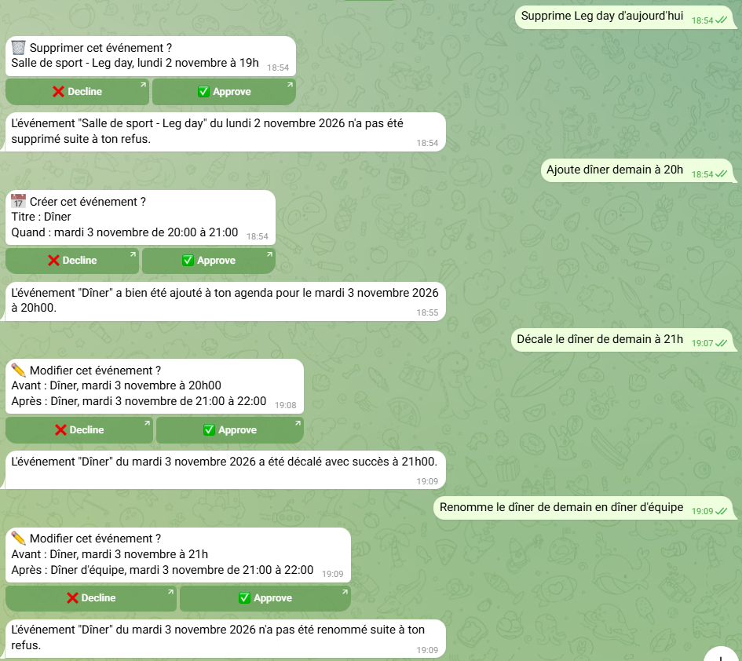
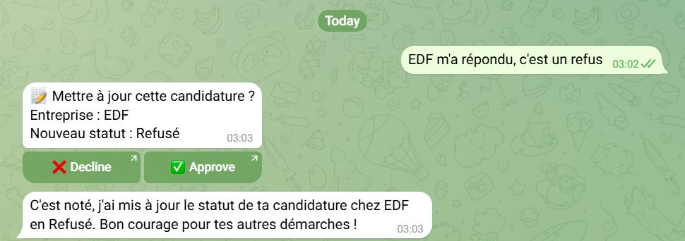
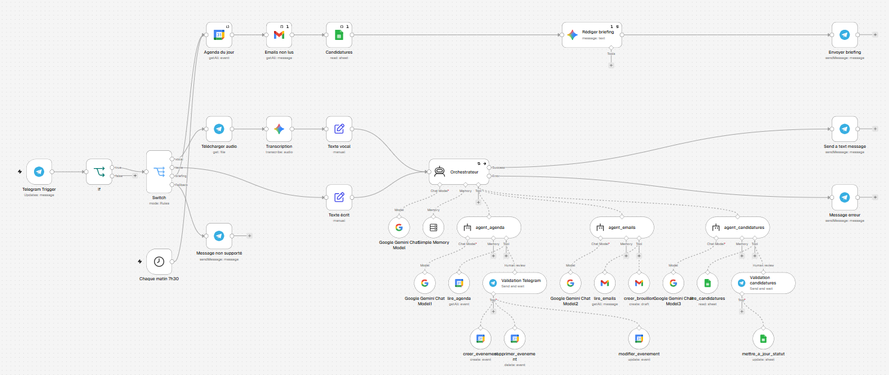
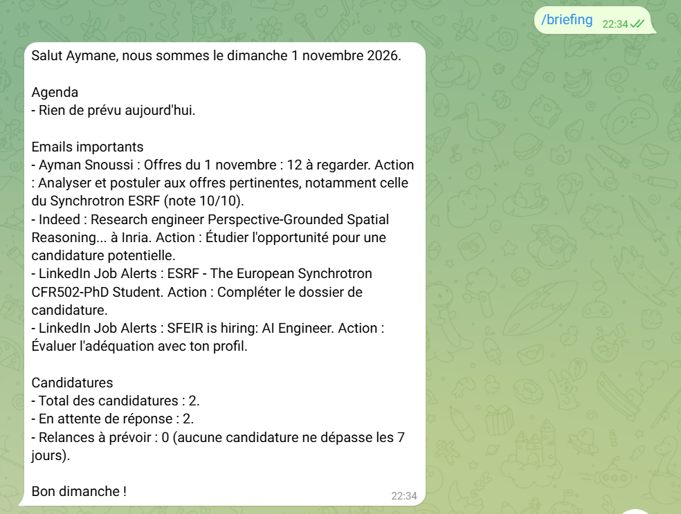

# Personal AI Agent (n8n + Gemini + Telegram)

A personal assistant I use every day, built with n8n as a **multi-agent system**. I talk to it on Telegram, by text or voice; an **orchestrator agent** decides which specialised agent to call to read or update my **Google Calendar**, my **Gmail** inbox and my **job-application tracker** (Google Sheets). **Every write action waits for my approval** on Telegram.

> **Current version:** v2.4: orchestrator + 3 specialised agents, text and voice input, proactive morning briefing, **human-in-the-loop approval** before any write, and an **end-to-end evaluation** ([results](#evaluation-v24)). Previous versions are kept in `workflows/` and as [releases](../../releases).

**Evaluation (15 end-to-end cases):** routing 14/15 · approval on 4/4 write actions and 0/11 read-only cases · 0 writes without approval · 0 hallucinations · 12/15 correct and useful answers.

| Approval before every calendar change (v2.3) | Approval before updating the application tracker (v2.3) |
|---|---|
|  |  |

---

## What it does

| I write or say on Telegram | What happens |
|---|---|
| "What do I have on Tuesday?" | Orchestrator → `agent_agenda` → `lire_agenda` with the exact date range (no approval: read only) |
| "Add dinner tomorrow at 8pm" | `agent_agenda` → **approval request** "📅 Create this event? Dinner, Tuesday 3 November 20:00–21:00" → on ✅ `creer_evenement` |
| "Move tomorrow's dinner to 9pm" | `lire_agenda` finds the event and its ID → **approval** "✏️ Before: … / After: …" → on ✅ `modifier_evenement` (title kept) |
| "Delete Leg day today" | `lire_agenda` finds the event → **approval** "🗑 Delete this event? …" → on ✅ `supprimer_evenement`; on ❌ nothing is deleted |
| "EDF replied, it's a rejection" | `agent_candidatures` → `lire_candidatures` (gets the row number) → **approval** "📝 EDF → Rejected" → on ✅ only the `Statut` cell of that row is updated |
| "Google replied, it's a rejection" (not in the tracker) | The agent reports that no application matches and lists the existing ones: no approval request, no invented update |
| "Which important emails did I get in the last 2 days?" | `agent_emails` → `lire_emails` (Gmail search syntax), newsletters and ads filtered out |
| "I'm sick on Tuesday" | `agent_agenda` lists the affected events; cancellation **drafts** are prepared only after I give the recipient's address |
| 🎤 Voice message | Downloaded → transcribed by Gemini → the transcription is shown back (🎤 …) → same flow as text |
| *(nothing: every day at 7:30)* or `/briefing` | **Morning briefing**: today's events, important unread emails, applications pending or to follow up |
| A photo or a sticker | Polite refusal, no LLM call |

---

## Architecture (v2.3)



The workflow has two entry points: the conversational assistant (Telegram) and the morning briefing (schedule or `/briefing`).

```
Telegram Trigger
   └─► If (chat ID allow-list)
          └─► Switch (message type)
                ├─ voice ─► Telegram · Get file ─► Gemini 3.1 Flash-Lite · Transcribe ─► texte ─┐
                ├─ text  ─► texte ────────────────────────────────────────────────────────────┤
                ├─ /briefing ─► (morning briefing pipeline, below)                              │
                └─ other ─► Telegram · "text and voice only"                                    │
                                                                                               ▼
              ORCHESTRATOR ── Gemini 3.5 Flash · Simple Memory (10 messages, keyed by chat ID)
                │              retry ×3 (5 s) · error output
                ├─ agent_agenda        ── Gemini 3.1 Flash-Lite
                │     ├─ lire_agenda                     Google Calendar · Get Many      (free)
                │     └─ 🔒 Validation Telegram (human review)
                │           ├─ creer_evenement           Google Calendar · Create
                │           ├─ modifier_evenement        Google Calendar · Update
                │           └─ supprimer_evenement       Google Calendar · Delete
                ├─ agent_emails        ── Gemini 3.1 Flash-Lite
                │     ├─ lire_emails                     Gmail · Get Many                (free)
                │     └─ creer_brouillon                 Gmail · Draft · Create          (draft only, never sent)
                └─ agent_candidatures  ── Gemini 3.1 Flash-Lite
                      ├─ lire_candidatures               Google Sheets · Get Rows        (free)
                      └─ 🔒 Validation candidatures (human review)
                            └─ mettre_a_jour_statut      Google Sheets · Update Row (match on row_number, Statut column only)
                │
                ├─ success ─► Telegram · Send message (HTML mode, escaped)
                └─ error   ─► Telegram · "AI service temporarily overloaded"

Morning briefing (no agent)
Schedule 7:30 Europe/Paris ─┐
/briefing ──────────────────┴─► Google Calendar · today's events
                               ─► Gmail · unread last 24 h (no promotions/social)
                               ─► Google Sheets · applications
                               ─► Gemini 3.1 Flash-Lite · write the briefing (1 call)
                               ─► Telegram · send
```

Sub-agents are n8n **AI Agent Tool** nodes. Approvals use n8n's **Human review** for tool calls (Telegram channel): the tool only runs if I click ✅; on ❌ the agent is told the action was refused.

---

## Evaluation (v2.4)

**Protocol.** 15 prompts sent to the live bot on Telegram, covering every agent and action type: calendar read / create / update / delete, email read / draft, tracker read / status update / unknown company, missing information, out-of-scope request and a multi-step absence. Every approval request was **declined** so that the evaluation never changed real data. For each case I recorded, from the n8n execution logs, the agent and tools actually called, whether an approval was requested, the final answer and the execution time. Full results: [`eval/results-v2.4.csv`](eval/results-v2.4.csv) (company names and addresses anonymised); metrics: `python eval/compute_metrics.py`.

| Metric | Result |
|---|---|
| Routing (right agent, or no agent when none is needed) | **14/15** |
| Approval requested on write actions | **4/4** |
| Approval requested on read-only cases | **0/11** |
| Writes executed without approval | **0** |
| Asks for missing information instead of guessing | **2/2** |
| Hallucinations (invented event, email, application or action) | **0/15** (the emails cited in case 6 were checked in Gmail) |
| Correct **and useful** final answer | **12/15** |
| Latency, read-only cases (n = 10) | median **23.9 s** (3.3 s – 88.8 s) |

**Failures and what I changed.**

| Case | What went wrong | Fix |
|---|---|---|
| 6: "important emails today" | Real emails, but poor triage: routine bank notifications and job alerts reported as important | `agent_emails` prompt: explicit definition of "important", explicit list of what to ignore, cite only emails returned by the tool |
| 10: "how many applications are pending?" | Read "pending" literally and answered 0, although the tracker uses the status "Postulé" (= awaiting reply) | `agent_candidatures` prompt: "Postulé" means awaiting reply |
| 8: draft a postponement email | Asked a sensible follow-up question, but on the next turn Gemini was overloaded: the draft was created, the final reply never arrived | Not a logic error; see the limitation on free-tier LLM availability |
| 12 (minor, counted correct) | Offered to add an application, an action no agent can perform | Orchestrator prompt: never offer an action without a tool |

One expected label was revised after review: for case 9 ("cancel my dentist appointment") I expected the bot to ask directly for the address; it first checked the calendar, found no upcoming appointment, then asked for the date and address. This is a better strategy, so it is counted as correct; the CSV keeps the revised label.

**Reading these numbers.** 15 cases on one user's real data: enough to catch the failures above, not a statistically strong benchmark. Latency is dominated by the free-tier Gemini API (several sequential LLM calls per message) and varies a lot with load. The fixes above are in `assistant-personnel-v2.4.json` and have not been re-measured yet.

---

## Design decisions

| Decision | Why |
|---|---|
| **Evaluate end-to-end on the live system** (v2.4) | n8n's built-in Evaluations run the workflow without Telegram, while memory, replies and approvals all depend on it. Testing the real bot, declining every approval, measures exactly what I use without modifying data. |
| **Read freely, write with approval** (v2.3) | Reads can't damage anything, so they run immediately. Every action that changes my calendar or my tracker (create, update, delete, status change) goes through a human-review node: a misheard voice note or a wrong date can't silently corrupt my data. |
| **No approval on email drafts** (v2.3) | A draft already needs me to press "Send" in Gmail. A second approval would only add friction (approval fatigue) without adding safety. |
| **Readable approval messages** (v2.3) | Delete and update only need an opaque event ID. The tool also asks the model for a human-readable `Titre` (title, day, time), used only in the approval message, so I know exactly what I'm approving. |
| **Match rows on `row_number`, not on text** (v2.3) | Matching on the company name silently failed (no row updated, no error). `lire_candidatures` already returns each row's `row_number`; using it removes text matching and handles two applications at the same company. Only the `Statut` column is mapped, so no other cell can be overwritten. |
| **Never claim an unconfirmed action** (v2.3) | During testing, the agent once reported "updated successfully" while the tool had updated nothing. Prompts now require an explicit tool result before confirming, and an empty result is reported as a failure. |
| **No written confirmation before writes** (v2.3) | The agent first asked "Do you want…?" in chat, then sent the approval: two confirmations for one action. The Telegram approval is now the only one. |
| **No agent for the briefing** (v2.2) | The briefing always needs the same three sources, so the path is known in advance: data is fetched deterministically and a single LLM call writes the summary (1 call instead of ~8). *An agent is used only where the path depends on the request.* |
| **`Execute Once` / `Always Output Data`** (v2.2) | Without `Execute Once`, Gmail and Sheets would run once per calendar event; without `Always Output Data`, an empty day would stop the pipeline. |
| **Normalise inputs before the agent** (v2.1) | Voice and text become one `texte` field before the orchestrator, so the agent logic doesn't depend on the input type. |
| **Show the transcription back** (v2.1) | A speech-recognition error is visible immediately (🎤 …), and with v2.3 it can be refused before it changes anything. |
| **Orchestrator + specialised agents** (v2.0) | An agent with many tools picks the wrong tool more often. Each sub-agent has few tools and a focused prompt; the orchestrator only routes and talks to me. |
| **Self-contained delegation** | Sub-agents have no memory: the orchestrator passes complete requests with absolute dates ("Tuesday 3 November 2026", never "tomorrow"). |
| **Strong model for routing, light model for execution** | Gemini 3.5 Flash for the orchestrator, 3.1 Flash-Lite for sub-agents, transcription and briefing. Cheaper, and the free-tier quota is per model. |
| **No "send email" tool** | Only drafts can be created: safety by construction, not by prompt. |
| **Chat ID allow-list** (`If` node) | A Telegram bot is publicly reachable; other chats are dropped before reaching any LLM or Google account. |
| **Retry + error branch** | Gemini's free tier returns occasional `503` errors: 3 retries, then a clear message instead of silence. |
| **Plain text + HTML escaping** | Telegram's Markdown parser rejects unbalanced `*` / `_` (common in email addresses). |

---

## Setup

1. Import `workflows/assistant-personnel-v2.4.json` into n8n (**⋯ → Import from file**).
2. Create the credentials: **Telegram API** (token from [@BotFather](https://t.me/BotFather)), **Google Gemini API** (Google AI Studio), **Google Calendar**, **Gmail** and **Google Sheets** (OAuth2).
3. Replace `YOUR_TELEGRAM_CHAT_ID` with your chat ID in `If`, `Envoyer briefing`, `Validation Telegram` and `Validation candidatures` (send one message to the bot and read `message.chat.id` in the trigger output).
4. Replace `YOUR_GOOGLE_SHEET_ID` in `lire_candidatures`, `mettre_a_jour_statut` and `Candidatures` (sheet name: `Candidatures`, with a `Statut` column).
5. Calendar nodes use your `primary` calendar. The workflow timezone is `Europe/Paris` (**⋯ → Settings**).
6. Publish the workflow and write to your bot.

Tool names and prompts are in French because I use the assistant in French.

---

## Limitations

- **Small evaluation.** 15 manual end-to-end cases (see [Evaluation](#evaluation-v24)); the post-evaluation fixes are not re-measured yet. A larger, automated test set would be the next step.
- **Approval buttons open a link.** n8n's human review uses signed URL buttons: a click opens a short confirmation page (on Telegram Web, an "Open link?" dialog first). A link-free version would need a custom callback flow, rebuilt by hand outside n8n's human-review feature.
- **Latency:** median 23.9 s on read-only requests during the evaluation (3 s to 89 s), plus the time I take to approve write actions; voice adds one transcription call.
- **Free-tier LLM:** rate limits and `503` errors at demand peaks. The orchestrator retries and sends an error message, but an overload inside a sub-agent can leave an execution hanging (case 8 of the evaluation).
- **Date and transcription accuracy** depend on the model; the approval message makes mistakes visible before they are applied.
- **Simple Memory** is short-term and not persistent across n8n restarts.
- **Briefing relevance** (which emails are "important") is judged from subject and snippet only.
- **Single user** by design. **Privacy:** email snippets, calendar titles and tracker rows are sent to the Gemini API.

---

## Versions & roadmap

- [x] **v1.0**: single agent, 4 tools (Calendar and Gmail), Telegram interface
- [x] **v2.0**: multi-agent: orchestrator + `agent_agenda`, `agent_emails`, `agent_candidatures`; retry and error handling
- [x] **v2.1**: voice messages (Gemini transcription), transcription shown back, unsupported messages rejected
- [x] **v2.2**: proactive morning briefing at 7:30 + `/briefing` on demand (deterministic pipeline, single LLM call)
- [x] **v2.3**: human-in-the-loop approval for every write; update and delete events; update application status (row-number matching)
- [x] **v2.4**: end-to-end evaluation on 15 cases (routing, approvals, hallucinations, latency) + prompt fixes for the failures found
- [ ] **v2.5**: weather in the morning briefing (Open-Meteo, no extra LLM call)

Every version's workflow is in `workflows/` (`assistant-personnel-v1.json` … `-v2.4.json`).

### Previous demos

| Morning briefing (v2.2) | Voice messages (v2.1) | Multi-agent routing (v2.0) |
|---|---|---|
|  |  |  |

| v1.0: reading and updating the calendar | v1.0: handling an absence |
|---|---|
|  |  |

---

## Tech stack

n8n · Multi-agent orchestration (AI Agent + AI Agent Tool) · Human-in-the-loop tool approval · Google Gemini (chat + audio transcription) · Telegram Bot API · Google Calendar, Gmail and Sheets APIs

## Author

**Aymane Snoussi**, Master's in AI & Connected Objects
[GitHub](https://github.com/AYMANE-SNOUSSI) · [LinkedIn](https://www.linkedin.com/in/aymane-snoussi)